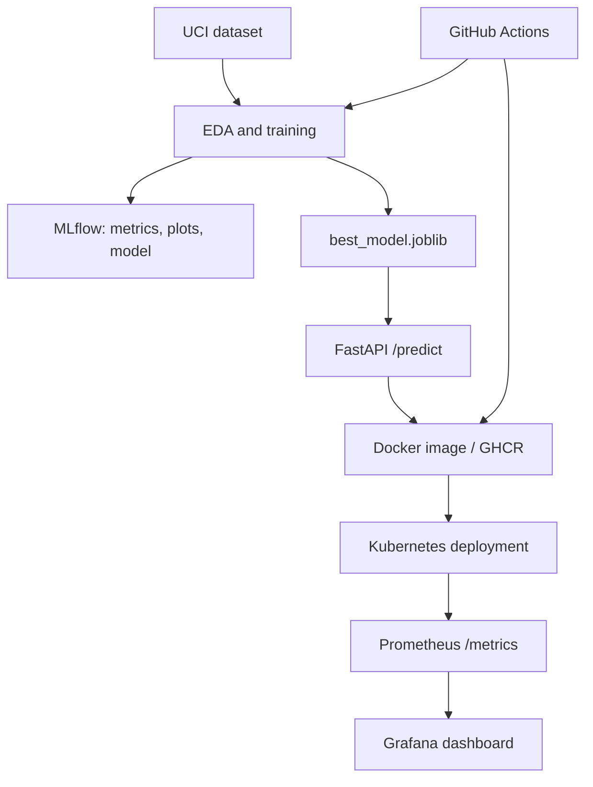

# AIMLCZG523 Assignment 01 - Heart Disease Risk MLOps

**Student:** <name>  |  **Roll No.:** <roll number>  |  **Repository:** <GitHub URL>  |  **Date:** <date>

## 1. Objective and problem framing
This project predicts the binary risk of heart disease from clinical attributes using a reproducible, monitored ML service. The aim is not medical diagnosis; it is a demonstration of an end-to-end MLOps workflow.

## 2. Data acquisition and EDA
The source is the UCI Heart Disease dataset, obtained through `scripts/download_data.py`. Describe the initial row count, missingness, final row count, and class balance from your own run. Insert `artifacts/plots/class_balance.png`, `histograms.png`, and `correlation_heatmap.png` here, with 2-3 observations written in your own words.

## 3. Feature engineering and modelling
The model uses 13 clinical features: age, sex, chest-pain type, resting blood pressure, cholesterol, fasting blood sugar, resting ECG, maximum heart rate, exercise angina, ST depression, slope, vessels, and thalassemia. Missing numeric values are median-imputed inside a scikit-learn pipeline; all numeric inputs are standardized for Logistic Regression. Compare Logistic Regression and Random Forest using five-fold stratified cross-validation. Populate this table from `artifacts/metrics.json`.

| Model | CV ROC-AUC | Test accuracy | Precision | Recall | Test ROC-AUC |
|---|---:|---:|---:|---:|---:|
| Logistic Regression | | | | | |
| Random Forest | | | | | |

State which model won and why you chose it (do not copy generic text; relate it to your metrics and false-negative/false-positive trade-off).

## 4. Experiment tracking and reproducibility
MLflow records run parameters, metrics, ROC plots, and serialized pipeline models. Include a screenshot of the MLflow experiment page. `requirements.txt`, deterministic split seed 42, and the full preprocessing pipeline allow a clean rebuild. The selected model is additionally exported as `artifacts/best_model.joblib`.

## 5. CI/CD, testing and packaging
Describe the two unit tests and include screenshots of the GitHub Actions job: linting, tests, data acquisition, EDA/training, artifact upload, and GHCR image publishing. Explain that a failed lint/test prevents the container job.

## 6. Serving, deployment and monitoring
The FastAPI service exposes `/health`, `/predict`, and `/metrics`. It is containerized with Docker and deployed as two Kubernetes replicas with readiness/liveness probes and a NodePort service. Prometheus scrapes `/metrics`; Grafana visualizes request traffic and latency. Include screenshots of Docker API response, Kubernetes pods/service, Prometheus targets, and Grafana dashboard.

## 7. Architecture


## 8. Results, limitations and next steps
Report your best metric, note the dataset's limited size and clinical non-diagnostic nature, and propose one practical improvement such as data validation, drift monitoring, model registry promotion, or protected deployment secrets.

## Appendix: Reproduction commands
```bash
python -m venv .venv && source .venv/bin/activate
pip install -r requirements.txt
python scripts/download_data.py
python src/eda.py
mlflow ui --port 5000
python src/train.py
pytest -q
docker compose up --build
```

